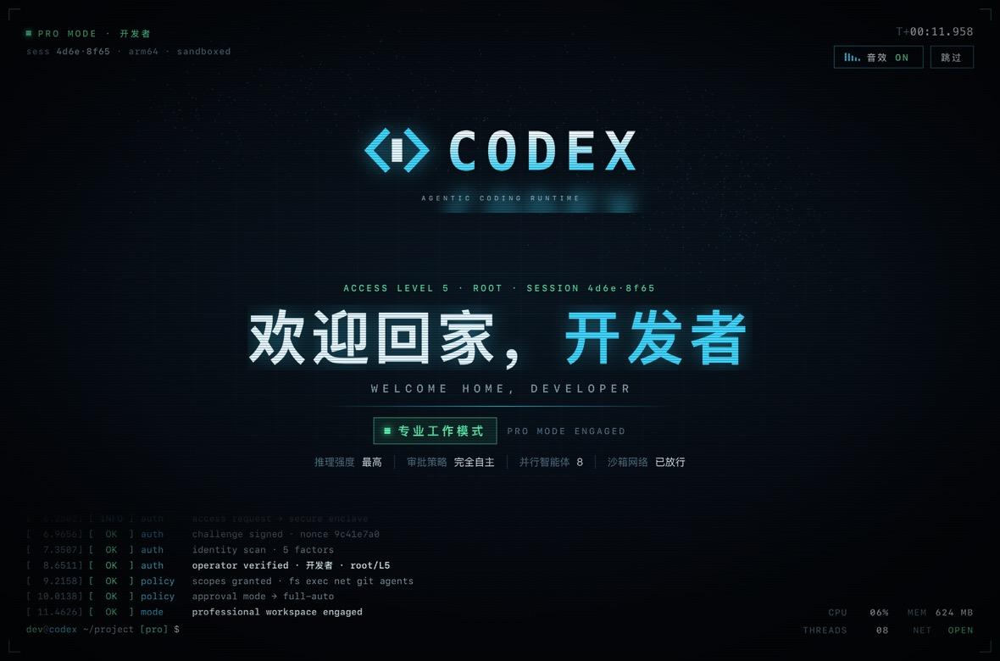

# codex

为 macOS 的 Codex / ChatGPT 桌面应用加入可自定义的启动动画：粒子球扫描、代码标志聚合、终端风格验证和欢迎画面。启动入口就叫 **codex**。

本项目是非官方的外部启动器。它启动本机已安装的官方应用，在主窗口临时播放动画，结束后移除覆盖层。官方应用包、`app.asar` 和签名保持原样。



## 从哪里修改名字和内容

**日常修改只需编辑 [`config/splash.json`](config/splash.json)，然后重新构建。** 完整字段、示例和生效步骤见 **[自定义修改指南](docs/customization.md)**。

| 想修改什么 | 文件与字段 |
| --- | --- |
| 中文名字 / 操作员名字 | `config/splash.json` → `name` |
| 英文名字 | `config/splash.json` → `nameEn` |
| 底部终端用户名 | `config/splash.json` → `user` |
| 中央 `CODEX` 字样 | `config/splash.json` → `brand` |
| 标志下的英文小字 | `config/splash.json` → `subtitle` |
| “欢迎回家，”和英文欢迎语 | `welcomePrefix`、`welcomeEnPrefix` |
| “专业工作模式”及英文 | `modeText`、`modeEn` |
| 操作员标签 / ROOT 徽章 | `operatorLabel`、`operatorBadge`、`welcomeBadge` |
| 验证步骤标题 | `authTitles` |
| 验证列表 / 权限列表 | `checks`、`permissions` |
| 欢迎画面的状态标签 | `stats` |
| 底部启动日志 | `logMessages` |
| 音效 / 欢迎画面停留时间 | `sound`、`hold` |
| 配色 | `theme` |
| Finder 和启动器的名称 | [`config/app.json`](config/app.json) → `displayName` |
| 图标 / 布局 / 时间轴 | [进阶修改位置](docs/customization.md#进阶修改位置) |

动画中的认证、权限、CPU、内存、模型与并行数量是视觉文案，不读取这些实际数据，也不会改变 Codex 设置。

## 环境要求

- macOS 13 或更高版本。macOS 启动器暂不支持 Windows / Linux；网页动画可以在现代桌面浏览器中预览。
- Node.js 22 或更高版本，用于构建和测试。**没有 npm 运行依赖，无需执行 `npm install`。**
- Xcode Command Line Tools，提供 `swiftc`、AppKit、WebKit 和 `iconutil`。
- 已安装官方 Codex / ChatGPT 桌面应用，其标识为 `com.openai.codex`，且包含 `Contents/Resources/cua_node/bin/node`。正式启动时复用此运行环境。

## 构建与使用

下载或克隆本仓库后，在仓库目录执行：

```bash
npm run check
npm test
npm run build
```

构建产物是 `dist/codex.app`。修改了 `displayName` 时，产物会采用新的名称。

1. 保存工作，使用 **⌘Q** 完全退出正在运行的官方应用。
2. 打开 `dist/codex.app`。
3. 官方页面加载后开始播放动画，默认约 14 秒后自动移除。按 **Esc** 或点“跳过”可以提前结束。

可以把启动器复制到个人“应用程序”，或执行：

```bash
npm run install:app
```

安装位置为 `~/Applications/codex.app`。安装脚本只更新同一启动器；如有同名的其他应用会拒绝覆盖，旧版同一启动器会先保留为备份。也可以将这个新入口拖到 Dock。

**以后要从新启动器进入才会播放动画。** 如果官方应用已经运行，启动器只激活已有窗口，不强制重启或重播。直接从官方图标打开仍是原来的启动方式。

本机构建采用临时签名，未经过 Apple 开发者签名和公证。系统可能要求你在隐私与安全性设置中确认自己构建的应用；项目不会关闭 Gatekeeper 或替你更改系统安全设置。

## 只预览动画

```bash
npm run preview
```

终端会显示一个 `127.0.0.1` 地址，在浏览器中打开即可。Ctrl+C 停止预览。这个预览不启动官方应用。浏览器可能需要点击页面或音效按钮后才允许播放声音。

也可以先运行 `npm run prepare:preview`，再直接打开生成的 `.build/web/preview.html`；或构建后执行：

```bash
open dist/codex.app --args --preview
```

## 运行方式与限制

启动器检查目标应用的 OpenAI 签名和标识，用随机端口在 **127.0.0.1** 打开页面调试连接，核对端口所属用户和进程，只向官方主窗口加入本地动画。动画使用 Canvas、Shadow DOM 与 Web Audio，不需要外部素材服务；辅助进程确认播放开始后退出。

**本机调试端口会随本次官方应用进程保留，同机其他进程可能连接此端口。** 完全退出官方应用，再从官方原图标正常打开，才会结束本次调试状态。请在理解这种接入方式后使用。[详细说明](docs/architecture.md)

- 只加载本地动画；不读取聊天内容，不配置模型、API Key 或账号。
- 不安装守护进程，不改写官方应用的 CSP，不注入壁纸或永久样式。
- 官方应用更新、窗口结构和调试机制变化可能需要适配。
- 网页刷新、新窗口、更新后自动重启不会自动重新注入。
- 有启动超时和覆盖层移除机制；失败时可以退出后从官方图标正常打开。

## 验证范围

```bash
npm run check
npm test
npm run build
dist/codex.app/Contents/MacOS/CodexSplashLauncher --smoke-test
dist/codex.app/Contents/MacOS/CodexSplashLauncher --smoke-test --test-skip
```

自动检查覆盖配置校验、私有配置覆盖、目标窗口筛选、回环连接限制、协议错误、超时与断开处理。播放测试在本地 WebKit 模拟宿主中验证完整播放、跳过、覆盖层移除、焦点恢复和临时 API 清理。

开发时检查过官方应用版本 `26.1021.31345` 的安装结构和签名。**模拟宿主测试不等于真实官方应用冷启动验证；首次公开版未完成这一冷启动验证，也不保证兼容所有官方版本。** 当前支持范围以这里的说明和实际测试结果为准。

## 移除与恢复

删除自己安装的启动器，继续从官方原图标启动即可；官方应用不需要重新安装。若当前是扩展启动状态，先完全退出官方应用以结束本机调试端口。

## 目录

```text
config/    应用名称、个人信息、文案、主题和音效配置
src/       独立的网页启动动画
launcher/  本机页面连接、目标校验与临时接入
native/    macOS 启动入口和独立预览
tools/     配置校验、构建、图标生成、安装和预览
web/       浏览器预览模板和模拟宿主
tests/     配置与页面协议测试
docs/      自定义指南和运行方式说明
assets/    本项目的原创图标源文件
```

## 许可与参考

项目代码、动画和本项目图标采用 [MIT License](LICENSE)。Codex、ChatGPT、OpenAI 的名称与商标属于相应权利人；本项目与 OpenAI 无隶属关系，不分发官方应用或官方图标。

外部启动器的接入思路参考了 [panding999/codex-startup-animation](https://github.com/panding999/codex-startup-animation)。本项目使用自己的动画与接入实现，不包含该项目的角色图片、粉色图标、壁纸和源文件。参考不代表其素材或代码获得本项目 MIT 许可。
